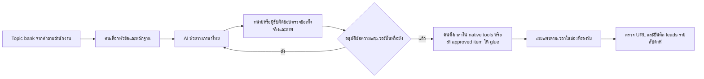

# Samnuan — แผนหาลูกค้าสำนักงานเล็กสายคดีความด้วยงบ 0 บาท

ปรับปรุง: **14 พฤศจิกายน 2026** · แผน 90 วัน: **14 พ.ย. 2026–11 ก.พ. 2027** · Research only, no code

**ข้อเสนอหลัก:** ขายให้สำนักงานไทย **1–10 ทนายที่ทำคดีแพ่ง/อาญา ติดตามหนี้ และบังคับคดีเป็นหลัก** เริ่มจากเรื่องเดียว: “พรุ่งนี้ใครไปศาล ต้องเตรียมอะไร กลับมาแล้วตามงานต่ออย่างไร” ใช้เว็บไซต์ samnuan.com, คอนเทนต์จากเดโมจริง, เทมเพลตฟรี, ชุมชนทนาย และผู้ก่อตั้งช่วยเริ่มใช้ ให้สำนักงานนำร่องฟรี 3–5 แห่งก่อนขยาย **ค่าโฆษณาและค่าเครื่องมือใหม่ 0 บาท** ไม่มีการ boost โพสต์หรือทดลองแพ็กเกจเสียเงินในแผนหลัก

งบ 0 หมายถึง **ไม่มีเงินสดเพิ่มสำหรับการตลาด** ไม่ได้แปลว่าค่าแรง เซิร์ฟเวอร์/EC2 โดเมน และการให้บริการ pilot ไม่มีต้นทุน ใช้ของเดิมตาม brief โดยต้องมีทรัพยากรเหลือ หากต้องเพิ่ม instance, จ่าย AI API, ซื้อ add-on หรือเพิ่มโควตา ให้ลดงานหรือกลับไปทำมือ ห้ามถือว่า free trial ของเครื่องมือเสียเงินเป็น free tier

**วิธีอ่านหลักฐาน:** ลิงก์รหัสในเนื้อหาเชื่อมแหล่งทางการในทะเบียนท้ายรายงาน พร้อมวันที่เข้าถึง **2026-11-14** แยกปีข้อมูลออกจากวันเข้าถึง ตัวเลขชั่วโมง เป้า funnel จังหวะส่ง เกณฑ์หยุด และ effort ทั้งหมดเป็น **ประมาณการ/เป้าทดลองของทีม ไม่ใช่สถิติตลาดหรือผลจริง** ไม่ได้เข้าบัญชีเครื่องมือ สมัครบริการ ติดต่อใคร หรือทดสอบ production

## 1. ICP เดียวที่เริ่มก่อน

| ประเด็น | ขอบเขตการทดลอง |
|---|---|
| ผู้ซื้อ | เจ้าของ/หุ้นส่วนสำนักงานคดีความไทย 1–10 ทนาย; รวมทนายเดี่ยว ไม่กำหนดว่าต้องมี 3 คนขึ้นไป |
| ผู้ใช้ | ทนายเจ้าของคดี ทนายไปศาล และผู้ช่วยที่เตรียมเอกสาร/ตามงาน; เลือกหนึ่งคนรับผิดชอบทดลอง |
| งานหลัก | คดีแพ่ง อาญา ติดตามหนี้ บังคับคดี ที่ต้องดูนัด เอกสาร ผู้รับผิดชอบ และกำหนดส่งต่อเนื่อง |
| สมมติฐานปัญหา | นัดอยู่หลายปฏิทิน; แฟ้มกับไฟล์แยกกัน; ไม่รู้ว่าใครตามงาน; ผลนัดไม่แปลงเป็นงานถัดไป; ลูกความถามสถานะซ้ำ ต้องยืนยันด้วยสัมภาษณ์ ไม่อ้างว่าทุกสำนักงานมีปัญหาเหมือนกัน |
| Trigger ซื้อ | เริ่มมีผู้ช่วย/ทนายร่วมทีม งานส่งต่อผิดพลาด หรือเสียเวลารวมข้อมูลก่อนวันศาล; ไม่ขายด้วยการข่มขู่ว่าจะพลาดคดี |
| เข้า pilot | ผู้ตัดสินใจร่วมเดโม ยอมเริ่มจากคดีตัวอย่าง/คดีที่ได้รับอนุญาต 3–5 คดี มีนัดหรืองานต่อในช่วงทดลอง และให้ feedback รายสัปดาห์ |
| ยังไม่รับ | ต้องย้ายข้อมูลทั้งหมดก่อนเห็นคุณค่า ต้องเชื่อมศาล/e-filing/ระบบทวงหนี้อัตโนมัติ ต้องใช้ offline ครบวงจร หรือมี procurement เกินกำลังทีม |

**ข้อเสนอทดลอง (ข้อเสนอใหม่ ต้องกำหนดเงื่อนไขก่อนเผยแพร่):** pilot ฟรี 30 วัน 3–5 สำนักงาน ช่วยเริ่มใช้ 30 นาที/แห่ง เริ่มด้วยนัดหนึ่งครั้งและงานต่อหนึ่งรายการ ไม่ต้องนำเข้าทั้งสำนักงาน หลังจบเสนอแพ็กเกจตามราคาที่ใช้งานจริงในวันนั้น ไม่สร้างราคาสมมติในรายงาน ขอ feedback และสิทธิทำ case study แยกต่างหาก ให้รีวิวตรงไปตรงมา ไม่บังคับคำชม ไม่เปิดข้อมูลคดี และไม่เปิดเผยชื่อสำนักงานโดยอัตโนมัติ

## 2. ตรวจฟีเจอร์ใน repo: ใช้คำอ้างได้ถึงไหน

ตรวจ source ที่ commit **`c92f0db318a19ac822855ff0bb34518f136f5100`** วันที่ 2026-11-14 หลักฐานนี้ยืนยัน implementation ใน checkout เท่านั้น ไม่รับรองว่าขึ้น production แล้วหรือเปิดทุกแพ็กเกจ ลิงก์ในตารางเป็นไฟล์จริงใน repo

| Pain → ข้อความที่ใช้ | หลักฐาน source | ขอบเขตที่ต้องบอก |
|---|---|---|
| นัดพรุ่งนี้/ใครไปศาล → “ดูนัดศาล กำหนด และงานประจำวันร่วมกัน” | [AgendaService](../../apps/api/src/agenda/agenda.service.ts), [My Day](../../apps/web/src/app/(dashboard)/my-day/page.tsx), [event responsibility](../../apps/api/src/calendar/event-responsibility.service.ts) | มีการรวม CalendarEvent/Task, ผู้รับผิดชอบ และรายการวันนี้/พรุ่งนี้; ไม่รับประกันการแจ้งเตือนถึงเครื่องทุกครั้ง |
| เตรียมแฟ้ม → “เช็กรายการเตรียมตัวและเอกสารก่อนวันศาล” | [CourtDayService](../../apps/api/src/calendar/court-day.service.ts), [Court Day DTO](../../apps/api/src/calendar/dto/court-day.dto.ts) | มี checklist, taskIds, document/version; ไม่อ้างว่าศาลยอมรับการยื่นเอกสารจากระบบ |
| กลับจากศาล → “บันทึกผลนัด แล้วกำหนดนัด/งานต่อและค่าใช้จ่าย” | [CourtDayService](../../apps/api/src/calendar/court-day.service.ts), [mobile Court Day](../../apps/mobile/app/court-day/[eventId].tsx) | complete ตรวจผลนัดและสร้างรายการตามสิ่งที่ผู้ใช้เลือก; ไม่อ้างว่า AI ตัดสินหรือส่งงานเอง |
| พลาดกำหนด → “ช่วยติดตามกำหนด โดยทนายตรวจวันก่อนใช้งาน” | [DeadlineRulesService](../../apps/api/src/deadlines/deadline-rules.service.ts), [Deadline controller](../../apps/api/src/deadlines/deadlines.controller.ts) | มีกฎ/ข้อเสนอวันที่ให้ทนายยืนยัน; ไม่กล่าวว่าเครื่องคำนวณกฎหมายสาธารณะพร้อมใช้หรือคำนวณได้ทุกกรณี |
| อยู่หน้าศาล → “ดูงานคดีและบันทึกผ่านมือถือ” | [mobile config](../../apps/mobile/app.json), [mobile calendar](../../apps/mobile/app/(tabs)/calendar.tsx), [mobile Court Day](../../apps/mobile/app/court-day/[eventId].tsx) | Android package `com.samnuan.app`; brief ระบุมี Play Store แล้ว แต่เปิดรายการสาธารณะไม่สำเร็จในรอบนี้ ต้องตรวจ install/login/flow ก่อนใช้ภาพโปรโมต ไม่อ้าง parity/offline |
| ลูกความถามสถานะ → “ให้ลูกความดูข้อมูลที่สำนักงานเลือกเผยแพร่” | [ClientPortalService](../../apps/api/src/client-portal/client-portal.service.ts), [portal case](../../apps/web/src/app/(client-portal)/portal/cases/[id]/page.tsx) | จำกัดตามสิทธิ/ข้อมูลที่เผยแพร่; Court Day มีการสร้างร่างอีเมลรายงาน ไม่ใช่ส่งถึงลูกความโดย AI เอง |
| สำรองค่าเดินทาง/คดี → “บันทึกค่าใช้จ่ายที่สัมพันธ์กับงานคดี” | [CourtDayService](../../apps/api/src/calendar/court-day.service.ts), [expenses page](../../apps/web/src/app/(dashboard)/expenses/page.tsx) | ไม่อ้างว่าทดแทนบัญชีทั้งหมดหรือรับรองภาษี |

**ห้ามใช้:** “ไม่พลาดกำหนดแน่นอน”, “AI รับรองกฎหมาย”, “ศาล/สภาทนายความรับรอง”, “เชื่อมศาลอัตโนมัติ”, “ประหยัดเวลา X%” ที่ยังไม่วัด, “อัปเดตลูกความเองโดยไม่ต้องตรวจ” หรืออ้าง bulk debt collection/enforcement integration เพราะ ICP ทำงานเหล่านั้น การตลาดใช้หลักเดียวกับผลิตภัณฑ์: **AI ร่าง → คนตรวจและอนุมัติ → ระบบทำเฉพาะสิ่งที่อนุมัติ**

## 3. ขนาดตลาดและความไม่แน่นอน

NSO รายงาน **การสำรวจธุรกิจทางการค้าและธุรกิจทางการบริการ พ.ศ. 2567** ตาราง 3 แถวกิจกรรมทางกฎหมาย 691/6910/69100: **5,472 สถานประกอบการ คนทำงาน 21,288 คน** อ้างอิงการดำเนินงาน **ปี 2566 (2023)** เป็นค่าประมาณกิจกรรมทางกฎหมายโดยรวม ไม่ใช่ทะเบียนสำนักงานทนาย active และคนทำงานไม่เท่ากับทนาย [รายงาน NSO][M1] วันที่ตรวจ 2026-11-14; ไฟล์ทางการเปิดได้ในรอบตรวจหนึ่งครั้ง แต่บางการเปิดซ้ำตอบ 403

- **TAM proxy:** 5,472 สถานประกอบการในนิยามข้างต้น ใช้บอกขนาดฐานกิจกรรมเท่านั้น ไม่บวกจำนวนใบอนุญาตทนายซ้ำ
- **SAM ของ ICP:** ยังไม่มีตัวเลขทางการที่แยก “1–10 ทนาย + สายคดีความ + พร้อมจ่าย SaaS” จึงไม่ตั้งสัดส่วนแล้วเรียกเป็นข้อเท็จจริง ไม่คำนวณมูลค่าตลาดจากราคา Samnuan ที่ยังไม่ได้ตรวจ
- **SOM เป้าทดลอง 90 วัน:** 40 qualified leads → 20 สำนักงานสมัคร → 12 สำนักงาน activated → 5 สำนักงานจ่ายเงินจริง เป็นเป้าสมมติตามกำลังทีม ไม่ใช่ market-share forecast; สำนักงาน pilot ที่ยังฟรีไม่นับเป็น paying
- วิธีลดความไม่แน่นอน: ผู้ก่อตั้งคัดรายชื่อธุรกิจด้วยมือ เก็บขนาดทีม/ประเภทงานจากที่สำนักงานยืนยัน สำรวจวิธีจัดการนัด เหตุผลไม่ซื้อ และผู้มีสิทธิตัดสินใจ แยก “รายชื่อที่พบ” ออกจาก “ผู้สนใจจริง”

## 4. คู่แข่งและของเดิมที่ต้องชนะ

ข้อมูลผู้ขายคือคำกล่าวของผู้ขาย ณ วันที่เข้าถึง ไม่ใช่ผลทดสอบเทียบ และไม่แปลว่าเหมาะกับกฎหมายไทยโดยอัตโนมัติ

| ทางเลือก | สิ่งที่ตรวจจากต้นทาง | Samnuan ควรตอบอย่างไร (ข้อวิเคราะห์) |
|---|---|---|
| แฟ้ม + ปฏิทิน + LINE/ไฟล์ตารางเดิม | ใช้เป็นสมมติฐานทางเลือกทดแทน ต้องถามสำนักงานจริง ไม่อ้างส่วนแบ่งตลาด | เดโมนัดหนึ่งครั้งครบก่อน/หลังศาล ให้เห็นว่ารวมงานแล้วคุ้มภาระย้ายข้อมูลอย่างไร |
| Smart Law ไทย | เว็บไซต์เสนอคดี แบบฟอร์มศาล เอกสารและตารางนัด; มีแพ็กเกจหลายระดับ [ผู้ขาย][C1] | แข่งที่ workflow วันศาลและการช่วยเริ่มใช้ ไม่ใช้ “เจ้าเดียว/ถูกที่สุด” |
| Lawzana Flow | ฟรีสูงสุด 2 seats มี matter/contact/lead, time tracking, invoices, portal; หน้าแสดง Essentials $29/seat/เดือน และ Advanced $79/seat/เดือน [ราคา][C2] | สำนักงานเดี่ยว/สองคนมีคู่แข่งเริ่มฟรีจริง จึงต้องพิสูจน์ภาษาและการทำงานคดีไทย ไม่แข่งด้วยคำว่ามี portal อย่างเดียว |
| CaseFox | หน้าเสนอ Solo ฟรี 4 cases/2 users และมี legal calendaring, documents, billing [ผู้ขาย][C3] | เดโมความต่อเนื่องนัด–ผลนัด–งานต่อ ตรวจข้อจำกัดจริงก่อนเทียบราคา/ความสามารถ |

ไม่จำเป็นต้องซื้อเครื่องมือสืบคู่แข่ง ใช้หน้าเว็บสาธารณะกับเหตุผลแพ้จาก lead ที่ยินดีตอบ ห้ามปลอมเป็นลูกค้าเพื่อขอข้อมูลลับ

## 5. ช่องทางหลักฟรีและสิ่งที่ต้องผลิต

ทุกแถวเป็นข้อเสนอการทดลอง ไม่มีค่า placement/sponsor/ค่าคอมมิชชันเป็นเงิน ใช้คอนเทนต์ต้นฉบับหนึ่งชุดแตกเป็นหลายรูปแบบ ไม่ตั้งทีมเล็กให้ผลิตคนละชุดทุกเครือข่าย

| ช่องทาง | งานที่ทำด้วยงบ 0 | CTA และการวัด |
|---|---|---|
| SEO บน samnuan.com | เริ่มหัวข้อ “เช็กลิสต์เอกสารไปศาล”, “ตารางนัดศาลสำนักงานทนาย”, “แบบบันทึกผลนัด”, “ตารางติดตามคดีบังคับคดี”, “ระยะเวลาอุทธรณ์: สิ่งที่ต้องตรวจ”, “คำนวณวันนัดศาล/กำหนดส่ง” คำเหล่านี้เป็น topic hypotheses ไม่มี search-volume ที่ยืนยัน | บทความ → ดาวน์โหลดแบบเปล่า/ชมเดโม → สมัคร; ใช้ Search Console ตรวจ query/click/indexing ฟรี ไม่รับประกันอันดับ [G1] |
| Lead magnets/เครื่องมือฟรี | ระยะแรกแจก checklist วันศาล แบบบันทึกผลนัด ตารางผู้รับผิดชอบ และแบบร่างแจ้งลูกความ ใช้ข้อมูลสมมติ อ่าน/ดาวน์โหลดได้โดยไม่บังคับให้เบอร์ แล้วเชิญรับอัปเดตแบบ opt-in | วัดคนขอเดโม/สมัครหลังอ่าน ไม่ถือยอดดาวน์โหลดเป็น lead ที่ยินยอมการตลาด |
| หน้า deadline calculator | **ข้อเสนอภายหลัง ยังไม่ยืนยันว่ามีหน้า public ใน repo** เริ่มบทความ/worksheet ตรวจชนิดคดี เหตุเริ่มนับ วันหยุดและข้อยกเว้นโดยทนาย; ทำ calculator เฉพาะเมื่อมีผู้ตรวจและเวลาพัฒนาในงานอื่น | ห้ามเขียน “คำนวณอุทธรณ์ได้ถูกต้องทุกกรณี”; หน้า tool ต้องอธิบายฐานกฎหมาย/วันที่ทบทวนและให้ยืนยัน ห้ามใช้วันตัวอย่างเป็นคำแนะนำคดีจริง |
| Facebook Page + กลุ่มทนาย | เพจโพสต์ความรู้/เดโม 3 ครั้งต่อสัปดาห์; ผู้ก่อตั้งตอบคำถามในกลุ่มด้วยตนเองเมื่อมีประโยชน์ ขออนุญาตผู้ดูแลก่อนแชร์เทมเพลตหรือ demo ไม่แจก URL ซ้ำทุกกระทู้ | CTA ขอ checklist/นัดเดโม; เก็บ UTM แยก Page กับ group ที่อนุญาต และถามแหล่งที่รู้จัก |
| LINE OA Free | ใช้เป็นช่องให้ผู้สนใจทักเข้ามาขอแบบฟอร์ม/นัดเดโม ตอบคำถามจริง; broadcast เฉพาะ opt-in ในโควตา ดูรายละเอียดหัวข้อ 7 | วัดทักเข้า นัดเดโม ทดลอง ไม่ใช้จำนวนเพื่อนแทน leads; ฟรีไทย 300 ข้อความ/เดือน [T2], [T3] |
| YouTube Shorts + TikTok | คลิปเดโมแนวตั้ง 30–60 วินาที สัปดาห์ละหนึ่งชิ้นต้นฉบับ นำไฟล์เดียวกันปรับ caption ลงสองช่อง ใช้เคสสมมติ/หน้าจอที่ตรวจแล้ว; คนตรวจคำบรรยายและเผยแพร่ตามสิทธิ | ลิงก์เว็บที่บัญชีรองรับ/บอกชื่อเว็บบนจอ; วัดเข้าเว็บและ qualified leads ไม่ซื้อวิว; YouTube ตั้งเวลาได้ [T7], TikTok มี native scheduler ตามเงื่อนไข [T6] |
| Google Business Profile | **ทำเฉพาะเข้าเกณฑ์:** ธุรกิจต้องพบลูกค้าต่อหน้าในเวลาทำการ; SaaS ออนไลน์ล้วนไม่เข้าเกณฑ์ ห้ามสร้างสำนักงาน/ที่อยู่สมมติหรือยืมโปรไฟล์สำนักงานทนายมาขายซอฟต์แวร์ | ฟรีหากมีสิทธิจริง; แสดงหมวดผู้ให้บริการซอฟต์แวร์ตามจริง ไม่ใช้หมวดสำนักงานกฎหมายเพื่อแย่ง lead คดี [G2], [G3] |
| Play Store ASO | ใช้ listing เดิมตาม brief ทบทวนคำอธิบายไทย/ภาพนัดศาล–ผลนัด–งานต่อ ชื่อสูงสุด 30, short description 80, full description 4,000 ตัวอักษรตาม Google [G4] | ตรวจ listing และ install จริงก่อนแก้ในงานภายหลัง; วัด store visitors/install แล้วเชื่อม signup แบบไม่ใช้ข้อมูลคดี ไม่อ้างว่าติดตั้ง=สำนักงานใช้งาน |
| Referral แบบเครดิตเวลา | ข้อเสนอให้สำนักงานที่แนะนำได้ **ฟรี 1 เดือน** เมื่อสำนักงานใหม่จ่ายครั้งแรก กำหนดเพดานทดลอง **3 เดือน/สำนักงาน** ไม่มีเงินสด ไม่มีแบ่งค่าคดี | เงื่อนไขเป็นข้อเสนอใหม่ ไม่อ้างมี referral engine แล้ว; บันทึก/ให้เครดิตด้วยคนเมื่อระบบรองรับและตรวจผลต่อรายได้/สิทธิแพ็กเกจ ห้ามให้สิทธิแฝงโดยไม่มีข้อตกลง |
| พันธมิตร | เสนอ session ออนไลน์/เทมเพลตให้ชมรมคณะนิติศาสตร์ ผู้จัดกิจกรรมสภาทนายความ หรือ legal influencer แบบแลกความรู้ ไม่จ่าย sponsor ไม่ซื้อบัตร/เดินทาง; ข่าวสภามีตัวอย่างกิจกรรมวิชาชีพจริง แต่ไม่ยืนยัน slot ฟรีหรืออนุมัติ Samnuan [O1] | ขอแนะนำ pilot โดยสมัครใจ วัด office referrals; ใช้โลโก้/คำรับรองได้หลังได้รับอนุญาตเท่านั้น |
| Founder-led outreach | คัดเว็บไซต์/ช่องทางติดต่อธุรกิจที่ประกาศไว้เอง เริ่มข้อความเฉพาะสำนักงานขนาดเล็กครั้งละน้อย ขออนุญาตส่ง checklist/เดโม ไม่ดึงข้อมูลส่วนตัวจากกลุ่ม/ทะเบียนคดี | เริ่ม **5 สำนักงาน/สัปดาห์** เป็นเพดานทดลองด้านเวลา ไม่ใช่ safe harbor ทางกฎหมาย; ผู้ก่อตั้งตรวจฐานกฎหมายและข้อคัดค้านรายกรณี ดูหัวข้อ 10 |
| PR/free directories | ทำเรื่องเล่าจาก pilot ที่อนุญาตและ press kit บนเว็บเดิม เสนอสื่อ/ชุมชน startup–legal tech แบบ editorial; ทำเนียบ Thai Startup มีจริง [O2] แต่ยังไม่ยืนยันสิทธิสมัคร/ค่า listing ปัจจุบัน | ทำเฉพาะช่องที่เจ้าของยืนยันว่าฟรี ไม่มีการจ่าย priority listing; หากตรวจไม่ได้ให้พัก ไม่อ้างว่ามี legal-tech directory ไทยที่รับฟรีแน่นอน และไม่สมมติว่าเผยแพร่แล้ว |

**สิ่งที่ผลิตก่อน:** checklist หนึ่งหน้า + เดโม 60 วินาที + บทความหนึ่งเรื่อง + หน้าชี้ทางไปสมัครเดิม หน้า tool/บทความใหม่ทั้งหมดเป็นแผนงานอนาคต ในงานวิจัยนี้ไม่ได้สร้างหรือเผยแพร่หน้าเว็บ

## 6. ข้อความสื่อสารและ funnel

### ตัวอย่างข้อความสำหรับโพสต์/หน้าเว็บ (นำไปใช้เป็น ad copy ได้ภายหลัง)

| หัวเรื่อง | เนื้อความร่าง | CTA / หลักฐานที่ต้องอยู่ในชิ้นงาน |
|---|---|---|
| พรุ่งนี้ใครไปศาล เตรียมอะไรแล้วบ้าง | “รวมมุมนัดศาล งาน และผู้รับผิดชอบของสำนักงานเล็กไว้ใน My Day แล้วเปิดรายการเตรียมวันศาลต่อได้ ดูตัวอย่างด้วยคดีสมมติ” | ดูเดโม My Day → Court Day จากหน้าจอที่ตรวจจริง |
| กลับจากศาลแล้ว งานต่ออยู่ที่ไหน | “บันทึกผลนัด เลือกนัดถัดไป งานติดตามและค่าใช้จ่ายในขั้นตอนปิดวันศาลของ Samnuan ทนายตรวจข้อมูลก่อนยืนยัน” | ชมคลิปผลนัด → งานต่อ; ไม่ใช้คำว่า AI ทำเอง |
| แฟ้มวันศาลพร้อมหรือยัง | “ดาวน์โหลดเช็กลิสต์วันศาลฟรี แล้วดูวิธีเชื่อมรายการเตรียมตัวกับเอกสารในคดีของสำนักงาน” | ดาวน์โหลดแบบเปล่า ไม่บังคับสมัครเพื่ออ่าน |
| กำหนดส่งต้องมีคนตรวจและคนรับผิดชอบ | “ใช้ปฏิทินและงานช่วยติดตามกำหนด พร้อมให้ทนายตรวจวันและผู้รับผิดชอบก่อนใช้งานจริง” | ดูตัวอย่างกำหนดในระบบ; ไม่โฆษณาการคำนวณอุทธรณ์อัตโนมัติทุกกรณี |
| ให้ลูกความดูข้อมูลที่สำนักงานเลือกแชร์ | “เปิดให้ลูกความเข้าถึงข้อมูลที่สำนักงานเผยแพร่ผ่าน client portal และตรวจร่างรายงานก่อนส่ง” | เดโมสิทธิของลูกความด้วยบัญชีตัวอย่าง ไม่แสดงคดีจริง |
| เริ่มจากนัดเดียว ไม่ต้องย้ายทั้งสำนักงาน | “เปิดรับสำนักงานสายคดีความ 1–10 ทนายสำหรับโครงการนำร่อง 3–5 แห่ง ช่วยจัดนัด เอกสาร และงานต่อหนึ่งรอบ ขอ feedback ตรงไปตรงมา” | ขอรายละเอียด pilot; ใช้ได้หลังยืนยันเงื่อนไข 30 วันและกำลังดูแลจริง |

**Funnel ที่เสนอ:** คอนเทนต์/ค้นหา/การแนะนำ → แบบเปล่าหรือเดโมบนเว็บ → opt-in ขอช่วยเริ่มใช้ → คัดว่าเป็น ICP → สมัครหนึ่งสำนักงาน → สร้างคดี/นัด/งานตัวอย่าง → ใช้วันศาลหรือซ้อม flow → จ่ายเงินจริง → กลับมาใช้รอบถัดไป/แนะนำต่อ

**นิยามตัวเลขที่ต้องใช้เหมือนกันทุกช่อง:**

- `qualified lead`: สำนักงานตรง ICP ที่ยินดีให้ติดตามหรือขอเดโม ระบุ office key เดียว; รายชื่อสาธารณะ/คนกดไลก์/ยอด download/ผู้สมัครส่วนตัวไม่ใช่ qualified lead อัตโนมัติ
- `signup`: สำนักงานสร้างบัญชีสำเร็จ ตัด test accounts/สำนักงานซ้ำ; แยก signup ใน pilot กับทดลองปกติ
- `activated trial`: ภายใน 7 วัน สร้างคดีและนัดหรือกำหนดหนึ่งรายการ พร้อมผู้รับผิดชอบและ checklist/เอกสารอย่างน้อยหนึ่งอย่าง แล้วกลับมาใช้วันอื่นอีกครั้ง; เป็น **นิยามทดลอง** ไม่อ้างว่ามี event tracking ครบแล้ว
- `active trials`: สำนักงานที่ยังอยู่ในช่วงทดลองและมีการใช้งานสำคัญใน 7 วันที่ผ่านมา รายงานเป็นจำนวน ณ วันวัด; แยกจาก activated สะสม
- `paying office`: รับเงิน subscription สำเร็จ ไม่ใช่แค่กดราคา ไม่รวม pilot ฟรี เครดิตแนะนำ หรือเงินที่คืนแล้ว; retention ดู cohort ที่มีเวลาครบเท่านั้น

เริ่มทะเบียนแบบตารางในไฟล์/ระบบที่มีอยู่ ไม่ต้องซื้อ CRM: office key, source/medium/campaign/content, วันขอให้ติดต่อ, consent/legal-basis note, stage, signup/activation/paid dates, owner, next action, opt-out และเหตุผลไม่ซื้อ เก็บเฉพาะข้อมูลธุรกิจที่จำเป็น ไม่บันทึกคู่ความ/เนื้อหาคดี ตั้ง retention review **90 วัน** สำหรับ prospect ที่ไม่เดินต่อเป็นนโยบายเสนอ ไม่ใช่ระยะที่กฎหมายกำหนดตายตัว

ใช้ UTM ที่ลิงก์เว็บและถาม “รู้จักจากที่ไหน” เมื่อสมัคร/เดโม รายงาน first-known source หนึ่งช่องทางต่อสำนักงาน + assisted sources แยกต่างหาก หาก route สมัครยังไม่เก็บ UTM ให้ลงตารางด้วยมือ ไม่สมมติว่ามี tracking แล้ว อัตราแต่ละขั้นใช้จำนวนสำนักงานไม่ซ้ำและช่วง cohort เดียวกัน `activation rate = activated / signups ที่ครบ 7 วัน` และ `trial→paid = paid / trials ที่ครบช่วงตัดสินใจ` รายงาน sample size เสมอ

## 7. ระบบการตลาดอัตโนมัติ: เริ่มฟรี ให้คนคุมการเผยแพร่

### 7.1 Stack ที่เลือกและเพดานใช้งาน

**เลือกเริ่ม:** เว็บไซต์/เซิร์ฟเวอร์เดิม + Meta Business Suite สำหรับ FB/IG + LINE OA Free สำหรับคนทักเข้า + Resend เดิม + native YouTube/TikTok scheduler + Canva Free เมื่อจำเป็น ใช้ Buffer Free เป็น **ทางเลือกเพิ่มเมื่อช่วยลดเวลาได้จริง** ไม่ต้องติดทั้ง Buffer และ Metricool ให้ n8n เป็น glue ระยะถัดไปบนเครื่องเดิมเมื่อมี headroom ห้ามซื้อ SaaS หรือ AI API เพื่อให้ flow ดูอัตโนมัติครบ

| เครื่องมือ / ราคาเพิ่มต่อเดือน (บาท) | Free tier/ขีดจำกัดและการใช้จริง | แหล่งทางการ ณ 2026-11-14 |
|---|---|---|
| samnuan.com + server/EC2 เดิม: **0 เพิ่มแบบมีเงื่อนไข** | ทรัพยากรเดิมตาม brief ไม่ใช่ AWS free-tier guarantee ยังไม่ตรวจค่าใช้จ่าย/พื้นที่/CPU/RAM จริง ถ้าต้องขยายเครื่องให้เลื่อน automation ใช้ตารางกับ native tools | ข้อมูลจาก brief + ขอบเขต repo; ไม่ยืนยัน billing AWS |
| Meta Business Suite: **0 สำหรับงานพื้นฐาน** | จัดการ FB/IG ของตนเอง คนเลือกไฟล์/ข้อความและตั้งเวลา; ไม่รวมโฆษณา/แพ็กเกจพิเศษ ข่าวเปิดตัวทางการอธิบายการโพสต์ร่วมกัน [T1a] ส่วนหน้า Help ปัจจุบันติด login จึง **ยังไม่ยืนยันตัวเลขจำนวนโพสต์/หน้าต่างตั้งเวลาใน UI** ให้ตรวจในบัญชีและตั้งครั้งละสัปดาห์ ห้ามนำ limit ของ Graph API มาแทน UI | [ภาพรวม][T1a], [Help ตั้งเวลา—เปิดติด login][T1b]; ถ้าใช้ไม่ได้ใช้ Buffer Free สำหรับ FB/IG สองช่องแทนโดยไม่จ่าย |
| LINE OA ไทย Free: **0** | **300 ข้อความ/เดือน**; ใช้ inbox/การตอบและ broadcast ตามโควตา ไม่ซื้อ add-on Basic 1,280 บาท/15,000 ข้อความ, Pro 1,780 บาท/35,000 ก่อน VAT 7% เป็นข้อมูลเปรียบเทียบ **ไม่ใช่คำแนะนำให้ซื้อ** | [แพ็กเกจไทย][T2] |
| LINE Messaging API: **0 ภายใน OA quota** | push/multicast/broadcast/narrowcast นับโควตาตามผู้รับ; reply ไม่นับ API ไม่ให้โควตาแยกจาก OA จำนวนข้อความในหนึ่ง request ไม่เท่ากับจำนวนผู้รับ; ไม่ใช้ reply เป็นช่องเลี่ยง quota สำหรับ outbound | [วิธีนับ][T3] |
| Resend เดิม: **0 ภายใน Free** | transactional **3,000 emails/เดือน, 100/วัน UTC** รวมรับเข้า/ส่งออกและนับแต่ละผู้รับ; marketing ฟรีถึง **1,000 contacts/เดือน** ส่งได้ไม่จำกัดจำนวนตามหน้านี้; **3 verified domains** ต้องตรวจ plan/usage ของบัญชีจริง ไม่สมมติว่าระบบมี quota ว่างทั้งหมด | [quota][T4], [Broadcasts][T4b] |
| Canva Free: **0** | editor/asset ฟรีและพื้นที่ **5 GB** เพียงพอกับต้นแบบภาพชุดเล็ก ใช้เฉพาะ asset ที่มีสิทธิฟรี; ไม่พึ่ง Pro assets, paid Content Planner หรือ quota AI ที่ไม่ยืนยัน | [ราคา/Free][T5] |
| YouTube Studio / TikTok native: **0 สำหรับงานเผยแพร่พื้นฐาน** | YouTube ตั้งเวลาจาก private/scheduled ได้; TikTok official blog ระบุ web scheduler **15 นาที–10 วัน** สำหรับบัญชีที่รองรับ และแก้ video/caption/time ของรายการที่ตั้งแล้วไม่ได้ ต้องตรวจสิทธิในบัญชี; ไม่รับประกัน daily upload quota เพราะขึ้นกับแพลตฟอร์ม/บัญชี | [YouTube][T7], [TikTok][T6] |
| Search Console: **0** | ใช้ตรวจ query, click, indexing ของเว็บที่ยืนยันสิทธิ ไม่ให้ search volume ทั้งตลาด และไม่รับประกันอันดับ ไม่มี subscription ที่ต้องซื้อสำหรับงานนี้ | [Google][G1] |
| Google Business Profile: **0 ถ้าเข้าเกณฑ์** | จำกัดธุรกิจที่พบลูกค้าต่อหน้าตามเงื่อนไข; ออนไลน์ล้วนไม่ผ่าน ไม่ถือเป็นช่องที่มี lead แน่นอนในแผน | [เริ่มต้น][G2], [eligibility][G3] |
| Buffer Free (ทางเลือก): **0** | **3 channels, 1 user, คิว 10 posts/channel** เติมคิวใหม่เมื่อเผยแพร่แล้ว ไม่ใช่ 10 ต่อเดือน; **100 ideas**, AI Assistant รวมใน Free แต่ไม่พบ quota ร่างภาษาไทยเป็นตัวเลข; API **1 key / 3,000 requests ต่อเดือน** ตาม pricing ขณะตรวจ ใช้ 1 publisher หลัง approval ภายนอก ไม่อ้างมีทีม approve ฟรี | [ราคา][T8], [queue limit][T8b], [API][T8c] |
| Metricool Free (เปรียบเทียบ ไม่ติดเพิ่ม): **0** | **1 brand, 1 profile/เครือข่าย, 20 posts/เดือน**, analytics 30 วัน; ไม่รวม LinkedIn/X, export reports หรือ Make/Zapier integration ใน Free จึงไม่เลือกเป็นแกน automation หลายช่อง | [Free vs paid][T9] |

**ผลรวมงบเพิ่มที่เสนอ: 0 บาท/เดือน** ภายใต้เพดานข้างต้นและไม่ขยาย infra ไม่รวมค่าใช้จ่ายเดิม/ค่าแรง/รายได้ที่ยกเว้นให้ pilot/referral ถ้าข้อใดทำให้ต้องเสียเงิน ให้ตัดทางเลือกนั้นออกทันที ไม่มีเงื่อนไขว่าต้องซื้อเพื่อทำแผนต่อ

**ตัวอย่างคุม quota (สมมติ):** LINE ผู้รับ 50 คน × 4 broadcasts = 200 ข้อความ เหลือ 100 สำหรับ push/approval/nurture; 7 ข้อความ × 50 คน = 350 จึงส่ง drip ทั้งชุดผ่าน LINE ไม่ได้ ปรับจำนวน broadcast ด้วยสูตร `ผู้รับจริง × จำนวนครั้ง + push อื่น ≤ 300` และเผื่อข้อความที่ส่งไปแล้ว หากฐานโตเกินให้ลดความถี่/เลือกกลุ่มที่สมัครใจ หรือใช้อีเมล ไม่อัปเกรดอัตโนมัติ [T2], [T3]

Resend หากใช้ transactional สำหรับข้อความบริการ ให้กัน quota ของ reset password/invites/digest ก่อนเสมอ ตัวอย่างผู้รับ 20 คน × 7 ฉบับ = 140 เป็นเพียงการคำนวณ ไม่ยืนยันว่าเหลือ capacity จริง อีเมลการตลาดต้องไปเส้นทาง marketing/contacts พร้อม opt-out ไม่เรียกทุกข้อความว่า transactional เพื่อเลี่ยงข้อกำหนด API ส่งอีเมลแบบ transactional เมื่อเกิน quota ตอบ error และไม่ queue/retry ให้ ส่วน Broadcasts จัด queue/throttle/schedule ได้ตามเอกสาร เป็นคนละเส้นทาง [T4], [T4b]

### 7.2 Auto-posting: สิ่งใดอัตโนมัติได้จริง

| ช่องทาง/วิธี | หลังคนอนุมัติทำอะไรต่อได้ | สิทธิ/ข้อจำกัดและสิ่งที่ยังต้องทำมือ |
|---|---|---|
| Meta Business Suite | คนตั้งเวลาโพสต์ FB/IG แล้วระบบเผยแพร่ตามเวลา | ต้องมีสิทธิเพจ/บัญชีที่เชื่อม ตรวจ timezone/format ใน UI ไม่ต้องสร้าง developer app เพื่อใช้ Suite; ไม่อ้างเวลาล่วงหน้าสูงสุดที่ Help ยืนยันไม่ได้ [T1a], [T1b] |
| Facebook Pages Graph API | สร้าง/แก้โพสต์เพจและตั้งเวลาได้ โดย `published=false` + `scheduled_publish_time`; คู่มือ API ระบุ **10 นาที–30 วัน** | Page token + `pages_manage_posts` และ permissions ประกอบตาม endpoint เช่น `pages_read_engagement`, `pages_manage_engagement`; publisher ต้องมี task สิทธิของเพจ ตามคู่มือปัจจุบัน ไม่ใช้กับ personal profile [A1] |
| Meta App Review | role users ของ app ใช้ Standard Access ได้ตามประเภท app ที่เอกสารครอบคลุม; ผู้ใช้นอก app roles ต้อง Advanced Access | Advanced Access ต้องผ่าน App Review ราย permission และมี Business Verification ตามเงื่อนไข; ไม่สรุปว่าเพียงเป็นเจ้าของเพจแล้วโพสต์ API production ได้ทุกกรณี ต้องตรวจ app type/access ปัจจุบัน จึงไม่สร้าง app ใน 90 วันแรกถ้า native/Buffer ทำงานได้ [A3] |
| Instagram Platform | publish รูป/วิดีโอ/Reels/carousel ผ่าน media container → publish; scheduler ต้องเรียก publish ตามเวลาเอง | professional account; Instagram Login ใช้ `instagram_business_basic` + `instagram_business_content_publish`; Facebook Login ใช้ `instagram_basic` + `instagram_content_publish` + `pages_read_engagement` และเงื่อนไข Page ที่เชื่อม ไม่ปน permission สองเส้นทาง ต้องมีสื่อที่ API เข้าถึงได้และตรวจ publishing limit จาก endpoint ไม่อ้างไม่จำกัด [A2], [A3] |
| LINE OA Manager | คนเลือกกลุ่ม/เนื้อหา/วันเวลา แล้ว broadcast ตามเวลาที่กำหนด | ใช้ quota ไทยเดียวกัน ตั้งเวลา/preview/test ใน Manager ได้; UI scheduling ไม่แปลว่า Messaging API มี schedule parameter ทั่วไป [T2], [T3], [A4] |
| LINE Messaging API | glue รอถึงเวลาที่อนุมัติแล้วจึงเรียก push/broadcast ไปยังผู้มีสิทธิรับ | ต้องมี channel token/user ID จาก flow ที่ถูกต้อง ตรวจ quota ก่อนส่ง ไม่จับคู่อีเมลเป็น LINE user ID เอง ผู้ add friend ไม่ได้แปลว่ายินยอมให้ติดตามทุกวัตถุประสงค์ [T3] |
| TikTok Direct Post API | อาจส่งอัตโนมัติหลังผู้ใช้ authorize/consent ตาม UX ของ API | ต้องอนุมัติ `video.publish`; client ไม่ audit ถูกจำกัด SELF_ONLY และสูงสุด 5 users/24 ชม.; guideline ไม่ยอมรับ utility ที่ทำเพื่อโพสต์เฉพาะบัญชีของทีมตนเอง จึง **ไม่เลือกสร้าง internal TikTok autoposter** ใช้ native หรือผู้ให้บริการที่ได้รับสิทธิ [A5], [A6] |
| TikTok/IG ผ่าน scheduler | auto-publish เฉพาะประเภทโพสต์/บัญชีที่รองรับ | music/effects/บาง format อาจต้องจบใน native app ให้คนตรวจหน้าจอ publish method ก่อนเข้าคิว ไม่อ้างทุก format fully automated; ถ้าไม่รองรับตั้ง reminder ให้คนลงเอง |
| LinkedIn Page API | โพสต์ในนามองค์กรผ่าน Community Management APIs | scope `w_organization_social`, สิทธิ admin/role ที่ตรง และการอนุมัติ access; Development จำกัดการเรียก Standard ต้องสมัครเพิ่ม ไม่ใช่สมัคร API แล้วใช้ unrestricted ทันที [A7], [A8] ใช้โพสต์มือ/Buffer ในอนาคตเมื่อเห็น lead ไม่ตั้ง LinkedIn เป็นช่องหลัก |
| YouTube | คน upload ตรวจภาพ/เสียง/caption ตั้งเวลา แล้วระบบเผยแพร่ | ใช้ Studio ไม่สร้าง API integration ใหม่; อาจไม่เผยแพร่ขณะบัญชีติด penalty ตามเงื่อนไขแพลตฟอร์ม [T7] |

**ระดับ automation ที่ทำได้ในงบศูนย์:** native scheduling ทำอัตโนมัติได้ตั้งแต่รายการที่คนตั้งเวลาแล้ว ไม่ได้หมายถึง AI คิดจนโพสต์เองทุกขั้น ขั้น draft ภาษาไทย/ตรวจคำกฎหมายยังมีคนทำ ส่วนการส่งผ่าน API ต้องมีสิทธิจริงและทดสอบกับบัญชีของทีมก่อน ไม่รับประกันจากการอ่าน docs อย่างเดียว

### 7.3 Content pipeline และปฏิทินต่อสัปดาห์

แนะนำเก็บ topic bank ในตาราง/ไฟล์ที่ทีมมี: pain, ICP, หัวข้อ, source/วันที่ทบทวน, feature proof, format, draft, ผู้ตรวจ, approved version, publish date, channel, CTA, UTM, URL หลังเผยแพร่, leads และเวลาที่ใช้ ห้ามใส่ข้อมูลคดีจริงใน topic bank หรือ AI prompt

AI drafting ใช้ **Buffer AI Assistant ใน Free** แบบคนกดสร้าง/ปรับร่างและคัดลอก ตรวจคุณภาพภาษาไทยเอง ไม่มีค่า AI API [T8] ไม่พบตัวเลขโควตา AI ที่รับประกัน จึงวาง fallback เป็นคนเขียนจาก template ไม่กำหนด workflow ที่ต้องเรียก AI API ฟรีได้ตลอด ห้ามใช้ browser bot คุม free chatbot แทน API และไม่ให้ AI เข้าถึง token เผยแพร่

**คำสั่งร่างตัวอย่าง:** “ร่างโพสต์สำหรับสำนักงานคดีความไทย 1–10 ทนาย หัวข้อเช็กลิสต์ก่อนวันศาล ใช้เฉพาะข้อเท็จจริงจาก feature proof ที่แนบ ไม่เพิ่มฟีเจอร์ ไม่ให้คำปรึกษาคดีเฉพาะราย ไม่รับประกันผล ให้ CTA ดาวน์โหลดแบบเปล่า หากไม่มีหลักฐานให้ระบุรอตรวจ” ผู้ตรวจต้องเปิด source เอง AI citation ไม่ใช่การตรวจหลักฐาน

| วัน/จังหวะ | ชิ้นงานและเนื้อหา | วิธีใช้ซ้ำ/เวลา (ประมาณการ) |
|---|---|---|
| ต้นสัปดาห์ | 1 บทความหรือปรับบทความเดิม: checklist ศาล / บันทึกผลนัด / ผู้รับผิดชอบ / กำหนดส่ง หมุนหัวข้อ | ค้นหลักฐาน+เขียน+ตรวจ รวม 2 ชม.; หัวข้อระยะเวลาอุทธรณ์ต้องทนายตรวจแยก ถ้าไม่ทันใช้เรื่อง workflow |
| จันทร์ | FB/IG ภาพ checklist วันศาล | แตกจากบทความ 30 นาที |
| พุธ | เดโม 30–60 วินาที “ผลนัด → งานต่อ” ลง Page/Reel แล้วใช้ไฟล์ต้นฉบับใน Shorts/TikTok | อัด/ตัด/ตรวจ/ตั้งเวลา 1.5 ชม. รวมทุกช่อง |
| ศุกร์ | FB/IG คำถามจาก pilot เช่น “ใครดูงานนี้” พร้อมหลักฐานหน้าจอสมมติ | 30 นาที; รวมเป็น 3 Page posts/สัปดาห์ ไม่ใช่เพิ่ม 3 ต่อแพลตฟอร์มโดยทำคนละชุด |
| จังหวะที่มีเรื่องมีประโยชน์ | LINE สรุปบทความ/เปิดรอบเดโม ไม่เกิน 1 ครั้ง/สัปดาห์และต้องลดตาม quota | ตั้งเวลา/ตรวจผู้รับ 30 นาที; เป็นความถี่สูงสุดเสนอ ไม่ใช่ต้องส่งทุกสัปดาห์ |
| ประจำสัปดาห์ | ตั้งคิว ตรวจลิงก์และทบทวนผล 1 ชม. | รวมงานผลิต/ตั้งเวลาประมาณ 6 ชม./สัปดาห์; ตอบกลุ่ม/ขาย/ดูแล pilot นับแยกในหัวข้อ 9 |

Topic bank เริ่มจาก 8 เรื่อง: เช็กลิสต์ไปศาล, เปิด My Day ก่อนออกสำนักงาน, มอบหมายคนไปศาล, บันทึกผลนัด, ตามเอกสารขาด, ตรวจฐานเริ่มนับกำหนดอุทธรณ์, เตรียมงานติดตามบังคับคดี, อัปเดตลูกความและค่าใช้จ่าย ตัวเลข cadence เป็นกำลังผลิตเสนอ ไม่ใช่สูตรอัลกอริทึม หากงานตรวจเกินเวลาให้ลดเหลือบทความทุกสองสัปดาห์ ไม่ลดการตรวจเพื่อให้ครบจำนวน

### 7.4 Automation glue: n8n เทียบ Make/Zapier

| ตัวเลือก | ต้นทุน/เพดานฟรี | LINE และความเหมาะสม |
|---|---|---|
| **n8n self-host Community — เลือกระยะถัดไป** | license เพิ่ม **0 บาท/เดือน** สำหรับ workflow ภายในองค์กร; ไม่มี monthly cloud credits แบบ Make/Zapier แต่จำกัดด้วยเครื่อง/API/feature Community และต้องดูแล backup/security เอง [N1], [N2] | ใช้ LINE integration หรือ HTTP Request ไป Messaging API ได้ [N3]; เหมาะเมื่อ server เดิมมี headroom และมีคนดูแล ไม่เอา n8n editor เปิดให้ลูกค้านอกองค์กรเป็นผลิตภัณฑ์โดยถือว่า license ฟรีครอบคลุม |
| Make Free — สำรองถ้าไม่ดูแล server | **0 บาท, 1,000 credits/เดือน, interval ขั้นต่ำ 15 นาที** ตาม pricing; หนึ่ง action ส่วนใหญ่ 1 credit แต่ไม่ใช่ทุกงาน โดยเฉพาะ AI [N4] | มี LINE integration [N5] เหมาะกับงานทดลองเล็ก แต่ workflow approval/หลาย action/retry ใช้ credits เพิ่ม; ไม่เลือกเป็นแกนที่ต้องจ่ายเมื่อโต |
| Zapier Free — ไม่เลือก | **0 บาท, 100 tasks/เดือน, two-step Zaps** [N6] | LINE อาจต้อง integration/webhook และสิทธิแพ็กเกจที่ยังไม่ตรวจ ไม่อ้างรองรับ LINE ฟรีครบ; chain หลายขั้น+approval+nurture ไม่พอดีกับแกนฟรีนี้ |

ใช้ n8n Community แบบผู้ดูแลคนเดียว ไม่พึ่ง shared credential/workflow permissions, SSO หรือ paid governance; ผู้ตรวจเนื้อหาอนุมัตินอก editor [N2] **ประมาณการ setup 6–10 ชั่วโมง** แบ่งภายใน 18 ชม./สัปดาห์โดยลดงานช่องรอง หากเครื่องไม่ว่างเลือก native ทั้งหมดได้ ไม่ต้อง deploy ในรอบวิจัยนี้

### 7.5 ห้า workflows ที่เสนอ (ยังไม่ได้สร้าง)

| Workflow | Trigger → ขั้นตอน → ผลลัพธ์ | คนอนุมัติ/ข้อจำกัดงบ 0 |
|---|---|---|
| 1. Topic → approved content → schedule | เตือนต้นสัปดาห์ → คนเลือก topic/ใช้ AI Free ร่าง → แจ้งผู้ตรวจทางอีเมลเดิม → approve ข้อความ/ภาพ/ช่อง/เวลา → publisher ตั้ง native หรือ n8n ส่ง Buffer API เฉพาะ channels ที่เชื่อมจริง → เก็บ URL/status [T8c] | ต้องมี approval record ผูก content version; แก้หลังอนุมัติต้อง approve ใหม่; ไม่มี approval/หมดอายุ/เนื้อหาเปลี่ยนให้ค้าง ห้าม AI publish เอง ไม่มีฟรี AI API ใน flow |
| 2. Organic lead → ทะเบียน → welcome | ผู้สนใจขอ template/เดโมผ่านช่องเดิม → คนลงทะเบียนข้อมูลขั้นต่ำ/สิทธิการติดตาม → ส่งไฟล์/ลิงก์ที่เขาขอ → ถ้า opt-in จึงเข้ากลุ่ม nurture → คนติดตาม trial signup | ไม่อ้าง form webhook/CRM integration มีแล้ว เริ่ม manual input; n8n ใช้ข้อมูลที่อนุญาตเท่านั้น อีเมล/LINE welcome ส่งจากข้อความที่คนอนุมัติและตาม quota ไม่ส่งสองช่องพร้อมกันโดยไม่จำเป็น |
| 3. Trial inactive 3 วัน → nudge | ทุกวันตรวจ cohort จากข้อมูลที่มีสิทธิอ่าน/ตารางที่ผู้ดูแลอัปเดต → แยกยัง trial/ยังไม่ active/ยัง opt-in → ส่งคำแนะนำ “ลองตั้งนัดแรก” หนึ่งครั้ง → หยุดเมื่อ active/opt-out | 3 วันเป็นค่าเสนอ **ยังไม่ยืนยัน field/event inactivity ที่เหมาะใน repo** จึงให้คนยืนยันรายการก่อน ไม่สร้างชื่อ field หรือเชื่อม DB production แบบเดา; ถ้าข้อมูลไม่พอคง manual และไม่ติดตามพฤติกรรมเกินจำเป็น |
| 4. Trial approaching end → นัดช่วย/แพ็กเกจ | ใช้ reminder เดิม T−7/T−1/T0 (หัวข้อ 8) → ทะเบียนจำว่าใครได้รับแล้ว → คนตอบคำถามและอัปเดต stage → เสนอ feedback หากไม่ต่อ | ไม่สร้าง cron ส่งซ้ำกับระบบเดิม; paid/หมดสิทธิ/ไม่ประสงค์รับ marketing ออกจาก marketing sequence โดยไม่ปิดข้อความบริการที่จำเป็น |
| 5. Weekly results + quota guard | รวมยอด leads/signup/active/paid ตามช่องจากตาราง → สรุปร่างรายงานให้เจ้าของ → ตรวจโควตา LINE/Resend/Buffer → แจ้งเตือน/พักคิวก่อนเกิน → คนตัดสินใจหัวข้อสัปดาห์หน้า | ไม่เพิ่ม subscription เอง; retry เฉพาะ transient errors แบบจำกัด ต้องเก็บ send ID/สถานะเพื่อกันส่งซ้ำ ไม่พบ published URL ไม่ถือว่าสำเร็จ |

จุดอนุมัติควรใช้อีเมลเดิมเป็นค่าเริ่มต้นเพราะไม่กิน LINE push quota ถ้าใช้ LINE ต้องนับข้อความถึงผู้ตรวจด้วย ส่วน Slack ไม่จำเป็นต้องเพิ่มบัญชี/เครื่องมือใหม่ให้ flow นี้ แยก “acknowledge receipt” ที่อนุมัติ template แล้วออกจากคำตอบกฎหมาย/ข้อเสนอรายบุคคลที่ต้องคนตรวจทุกครั้ง

## 8. Email/LINE nurture และ Resend ที่มีแล้ว

### สิ่งที่ source มีจริง

[EmailService](../../apps/api/src/notifications/email.service.ts) ส่ง HTTP POST ไป `https://api.resend.com/emails` ใช้ `RESEND_API_KEY`; ผู้ส่งยังอ่าน config ชื่อ `SENDGRID_FROM_EMAIL`/`SENDGRID_FROM_NAME` แม้ provider เป็น Resend มี reset password, invitations, portal และ trial reminders ไม่ได้แปลว่ามี marketing contacts/unsubscribe/drip พร้อมแล้ว

[TrialReminderService](../../apps/api/src/saas/trial-reminder.service.ts) มี cron 09:00 Asia/Bangkok แจ้งเจ้าของที่เข้าเงื่อนไขก่อนหมดอายุ **7 วัน, 1 วัน, วันหมดอายุ** ใช้ `trialEndAt/currentPeriodEnd` และ `trialReminderSentDays` ป้องกันส่งซ้ำตาม reminder point; มีเงื่อนไขข้าม card subscriptions ที่ต่ออายุเองและช่วง grace ของข้อมูลเก่า หลักฐานเป็นโค้ด ไม่ยืนยัน scheduler/provider/domain ใน production รอบนี้

**ข้อเสนอ:** เก็บ transactional เดิมไว้ แยก marketing nurture ไป Resend marketing contacts/segments/topics กับ Broadcasts ซึ่ง compose/test/schedule ผ่าน Dashboard หรือ API ได้ [T4b], [T4c] ยังต้องตั้งค่าในงาน execution ภายหลัง ไม่เรียกว่าระบบ drip สำเร็จรูปใน repo หยุด marketing เมื่อ unsubscribe/bounce/complaint/คัดค้าน และไม่ส่งเนื้อหาคดีให้ provider/ระบบการตลาด

### ลำดับ 7 ข้อความ (เวลาเสนอ ปรับตามวันสิ้นสุดจริง)

| เวลา | หัวเรื่องร่าง/เป้าหมาย | Trigger, CTA, คน/ระบบ |
|---|---|---|
| D0 หลังสมัคร | “เริ่มจากคดีและนัดแรกของสำนักงาน” → ให้เห็นงานแรก | ลิงก์คู่มือ/เดโม 60 วินาที + ชวนเริ่ม 1 คดี; template คน approve ก่อน auto-send; ถ้าข้อความเป็น promotion ต้องอยู่ใน marketing opt-in |
| D1 | “พรุ่งนี้ใครไปศาล” → เปิด My Day | ชวนใส่ผู้รับผิดชอบ+checklist; ถ้าทำแล้วใช้คำแนะนำขั้นต่อไป ไม่อีเมลว่าเขายังไม่ได้ทำโดยไม่มีข้อมูลยืนยัน |
| D3 เฉพาะยังไม่ active | “ให้ช่วยตั้งนัดแรกไหม” → แก้อุปสรรค | ผู้ก่อตั้งเสนอช่วย 15 นาที; ถ้าไม่มีข้อมูล inactivity ให้คนตรวจ ไม่ยิงตามเวลาอย่างเดียว ส่งครั้งเดียว ไม่บวกเป็นข้อความที่ 8 |
| D5 | “หลังนัด: ผลนัด งานต่อ และค่าใช้จ่าย” → ลองครบ workflow | ตัวอย่างสมมติ/ซ้อมสำหรับสำนักงานที่ยังไม่มีนัดจริง แล้วตอบอีเมลเพื่อขอช่วย ไม่รอศาลจริงถึงจะเรียนรู้ |
| T−7 | “เหลือเวลาทดลองตามที่บัญชีระบุ” → สรุปคุณค่า/อุปสรรค | ใช้ reminder เดิมที่เข้าเงื่อนไข **ไม่ส่ง marketing ซ้ำวันเดียวกัน** คนติดตามถ้าลูกค้าขอ; ไม่เดาว่า trial ทุกคนยาว 14/30 วัน |
| T−1 | “ตรวจงานที่ตั้งไว้และทางเลือกใช้ต่อ” → ตัดสินใจต่อ | ใช้ reminder เดิมพร้อม billing link/เงื่อนไขจริง ไม่สัญญาราคา/ส่วนลดที่ยังไม่ได้อนุมัติ |
| T0 | “สิ้นสุดช่วงทดลองตามบัญชี” → แจ้งสถานะ/เก็บเหตุผล | ใช้ reminder เดิมแจ้งผลตามระบบ; ถ้าไม่ซื้อขอ feedback แบบสมัครใจ หยุดสาย marketing ไม่ทวงซ้ำไม่มีกำหนด |

D0 คือวันสมัคร, T คือวันสิ้นสุดที่ตรวจจากบัญชี ถ้าวันชนกันให้รวม/ข้าม marketing เพื่อไม่เกิน **1 marketing touch/วัน** (นโยบายเสนอ); paid แล้วออกจาก trial marketing, pilot ขยายเวลาให้ใช้ T จริง ทุกข้อความการตลาดมีวิธีเลิกรับง่ายและเคารพ suppression ก่อนส่ง

**LINE ไม่ mirror อีเมลทุกฉบับ:** ใช้เพียงส่งลิงก์ที่ผู้ใช้ขอ/นัดช่วย หรือเลือก nudge หนึ่งครั้งสำหรับผู้เลือก LINE จริงและมี quota เหลือ ถ้าได้ reply จากลูกค้าให้คนสนทนาต่อ ข้อความบริการเดิมกับสิทธิเลิกรับการตลาดต้องจัดแยกตามวัตถุประสงค์ ห้ามใช้คำว่า transactional เป็นเหตุส่งโฆษณาโดยไม่จำกัด

## 9. แผน 90 วันนับเวลา และ KPI รายช่อง

**กรอบแรงงานเสนอ:** ทีมเล็กจัดสรรรวม **18 ชั่วโมง/สัปดาห์**: content+ตั้งเวลา 6, ผู้ก่อตั้งตอบกลุ่ม/outreach/พันธมิตร 6, demo/onboarding/support 4, วัดผล/ดูแล automation 2 ชั่วโมง คนเดียวรับหลายบทบาทได้ การ setup 6–10 ชั่วโมงแรกต้องโยกจากงานรอง ไม่บวกซ่อนนอกกรอบ หากมีเวลาน้อยให้เก็บเว็บ+Facebook+pilot แล้วลด LinkedIn/PR/ช่องวิดีโอรองก่อน

**เป้าสมมติวันที่ 90 แยก first-known source (รวม 40 leads ไม่ซ้ำ):**

| ช่องทาง | Qualified leads เป้าสะสม | สิ่งที่นับ/ข้อจำกัด |
|---|---:|---|
| SEO/lead magnets | 10 | ขอเดโมหรือยินดีให้ติดตามจากเว็บ ไม่เอา search clicks เป็น leads |
| Facebook Page/กลุ่มที่อนุญาต | 10 | แยกสอง sub-source ในทะเบียน |
| YouTube/TikTok | 5 | ลง first-known source ตามลิงก์/ผู้สมัครตอบ ไม่เอาวิวแทน |
| Founder outreach | 8 | ตอบสนใจและตรง ICP แล้วเท่านั้น ไม่ใช่จำนวนข้อความที่ส่ง |
| Referral/partnership | 5 | รายชื่อที่เจ้าของสำนักงานยินยอมให้แนะนำ ไม่เอา attendee list มาใช้ |
| Play Store organic | 2 | ยืนยันว่าเป็นสำนักงานตรง ICP ที่ยินดีติดตาม ไม่เอา install แทน |
| GBP/PR/directories | ไม่ตั้งขั้นต่ำ | ทดลองเมื่อสิทธิ/ฟรีชัดเจน ถ้ามี lead จริงให้ลงช่องจริงและปรับรวม ไม่บวกซ้ำ |

LINE เป็น **ช่องสนทนา/conversion** บ่อยครั้ง ไม่ควรแย่ง attribution จาก SEO/FB ให้เก็บว่า lead เริ่มจากไหนและเข้ามาทาง LINE กี่ราย ตัวเลขเป้าไม่ได้คำนวณจาก conversion rate ของแพลตฟอร์มที่ไม่มีหลักฐาน

| สัปดาห์ / วันที่ | งานหลักในเวลา 18 ชม. (ยกเว้นสัปดาห์สุดท้าย) | เป้าสะสม/จุดตรวจ (สมมติ) |
|---|---|---|
| 1 · 14–20 พ.ย. | ตรวจเดโม/ราคา/trial/สิทธิภาพ, ทำ checklist+ตาราง leads, ตรวจบัญชี/quota, เลือก native schedulers; กัน setup 6 ชม. แทนงานช่องรอง | นิยาม KPI และหลักฐานฟีเจอร์พร้อม; 3 leads ไม่เริ่ม API integration ใหม่พร้อมกันทุกช่อง |
| 2 · 21–27 พ.ย. | เปิดคอนเทนต์รอบแรกในงาน execution ภายหลัง, demo ให้ผู้สนใจ, คัด pilot, ตั้ง consent/opt-out workflow | 6 leads / 3 signups; บันทึกเวลาจริงก่อนเพิ่ม cadence |
| 3 · 28 พ.ย.–4 ธ.ค. | ช่วย pilot เริ่ม 1 นัด, ถาม pain, อัดคลิปสมมติครั้งเดียวใช้ซ้ำ | 9 leads / 5 signups / 2 activated สะสม; เช็ค active trials ณ สัปดาห์นั้นแยก |
| 4 · 5–11 ธ.ค. | เติม pilot ให้ได้ **3–5 แห่ง**, แก้ข้อความ/คู่มือจากงานจริง, ทดลอง nurture ที่อนุมัติแล้ว | 12 leads / 7 signups / 4 activated; ถ้าตั้งนัดแรกไม่ได้ให้ลดงานผลิตแล้วช่วยเริ่มใช้ |
| 5 · 12–18 ธ.ค. | ทบทวน pilot รุ่นแรกและการจ่าย, เผยแพร่บทเรียนเฉพาะที่ยินยอม | 15 leads / 8 signups / 5 activated / 1 paying; เป้ายอดจ่ายอาจมาจาก trial ปกติไม่ต้องเร่งเก็บเงิน pilot ก่อนครบเงื่อนไข |
| 6 · 19–25 ธ.ค. | เก็บ case study ที่วัดก่อน/หลังจริง; เสนอ online session/เทมเพลตแก่พันธมิตรโดยไม่จ่ายเงิน | 18 leads / 10 signups / 6 activated / 1 paying; ถ้าไม่มีผลวัดไม่เขียน % ประหยัดเวลา |
| 7 · 26 ธ.ค.–1 ม.ค. | ลดงานสดช่วงตารางทีม/ลูกค้าไม่พร้อม ใช้คิวที่คน approve แล้ว ตรวจ quota เปลี่ยนเดือน | 20 leads / 11 signups / 7 activated / 2 paying; ไม่ถือวันหยุดเป็นสาเหตุ conversion โดยไม่มีข้อมูล |
| 8 · 2–8 ม.ค. | ช่วยกลุ่มที่ค้าง activate, ปรับ SEO จาก query จริง, เริ่ม n8n เฉพาะงานซ้ำที่เห็นว่าคุ้มและมีเครื่องว่าง | 24 leads / 12 signups / 8 activated / 2 paying; ไม่เพิ่ม infra |
| 9 · 9–15 ม.ค. | ทดลอง referral ฟรีเดือนแบบ manual ภายใต้เงื่อนไขที่ประกาศ; ขยายหัวข้อที่นำมาถึง trial | 28 leads / 14 signups / 9 activated / 3 paying |
| 10 · 16–22 ม.ค. | วัด cohort pilot หลังใช้ต่อ, demo group เล็กออนไลน์แทนเดินทาง | 32 leads / 16 signups / 10 activated / 3 paying; แยกผู้ใช้ฟรีออกจากจ่าย |
| 11 · 23–29 ม.ค. | เพิ่มเวลาช่องที่ได้ qualified leads ต่อชั่วโมงสูงกว่า ปรับ listing หากผ่านตรวจจริง | 35 leads / 18 signups / 11 activated / 4 paying; ไม่เปลี่ยนทุกช่องพร้อมกัน |
| 12 · 30 ม.ค.–5 ก.พ. | ปิดงานช่วย trial เก่า สัมภาษณ์เหตุผลแพ้ ตรวจต่ออายุ cohort ที่ครบช่วง | 38 leads / 19 signups / 12 activated / 4 paying |
| 13 · 6–11 ก.พ. (6 วัน) | **15 ชั่วโมง** สรุป funnel แยกแหล่ง ชั่วโมงจริง ปัญหา/เหตุผลไม่ซื้อ และแผนถัดไป | 40 leads / 20 signups / 12 activated สะสม / 5 paying; active trials เป็น stock จริง ณ วันนั้น ไม่เอา activated สะสมแทน |

รวมกำลังเสนอ **231 ชั่วโมงใน 90 วัน** (12×18+15) ไม่มีค่าโฆษณาหรือเครื่องมือเพิ่ม เป้าอาจต้องลดหาก support จริงเกินกรอบ ให้รายงาน actual เทียบ target ไม่แก้คำนิยามเพื่อทำยอด

**ตัดสินใจทุกสัปดาห์:** รายงาน leads/signup/active trials/activated/paid ต่อช่อง, ชั่วโมงต่อ lead และต่อ activated, จำนวนคิว publish ล้มเหลว, opt-outs, quota ที่เหลือ หาก 5 signups ที่ครบ 7 วันแล้วยังไม่มี activated ให้โยกเวลาไป onboarding ก่อนเพิ่ม traffic; หากช่องใดใช้รวม 6 ชั่วโมงในสองสัปดาห์แล้วยังไม่มี qualified lead ให้ทบทวน pain/CTA และพักช่องรองได้ เกณฑ์นี้เป็นนโยบายทดลองไม่ใช่ statistical proof และ SEO ต้องดู indexing/query/เวลารอประกอบ ไม่ตัดสินว่าล้มเหลวจาก lead สองสัปดาห์อย่างเดียว

CAC เงินสดจาก ads = 0 ไม่ได้แปลว่า CAC รวม = 0 ใช้ `CAC รวม = (ชั่วโมงหาลูกค้า × ต้นทุนแรงงานที่ทีมกำหนด + ค่าใช้จ่ายเพิ่มจริง + ต้นทุนบริการ pilot/referral ที่จัดสรร) / สำนักงานใหม่ที่จ่าย` แยกรายได้ที่ยกเว้นกับต้นทุนเงินสด ไม่คำนวณเป็นตัวเลขจนมีต้นทุนจริง

## 10. สิ่งที่ไม่ทำอัตโนมัติและความเสี่ยง

| เรื่อง | เหตุผลและแนวปฏิบัติ |
|---|---|
| Cold DMs/ข้อความหาทนายจำนวนมาก | ข้อมูลติดต่อสาธารณะไม่ใช่ consent การตลาดโดยอัตโนมัติ PDPA ม.21–25 มีเงื่อนไขวัตถุประสงค์/ฐานกฎหมาย/การแจ้ง และ ม.32 ให้สิทธิคัดค้าน direct marketing [L1] จึงใช้ผู้ก่อตั้งตรวจเป็นรายสำนักงาน ติดต่อช่องธุรกิจตามวัตถุประสงค์ที่ประกาศ ให้ตัวตน/เหตุที่ติดต่อ/ที่มาข้อมูล/ทางปฏิเสธ บันทึกการคัดค้าน หยุดทันที; ไม่คิดว่าโควตา 5/สัปดาห์ทำให้ถูกกฎหมายเอง |
| Auto-join/auto-post กลุ่ม Facebook | ไม่ทำ bot เข้ากลุ่ม คัดลอกรายชื่อหรือโพสต์ซ้ำ ต้องปฏิบัติตามกฎกลุ่ม/สิทธิผู้ดูแล ใช้คนตอบจริง หน้า Meta spam policy เปิดไม่สำเร็จ 429 จึงไม่อ้างถ้อยคำนโยบายปัจจุบันเป็นคำยืนยัน [L3] การออกแบบนี้หลีกเลี่ยงพฤติกรรมสแปมตั้งแต่ต้น |
| Scraping personal data/รายชื่อคู่ความ | ไม่ scrape เบอร์ส่วนตัว สมาชิกกลุ่ม เลขคดี หรือสร้าง audience จากผู้มีคดี ม.25 ไม่ใช่ข้อยกเว้นให้ใช้ directory ทุกอย่าง และม.26 มีข้อกำกับข้อมูลอ่อนไหว [L1] ใช้ข้อมูลธุรกิจขั้นต่ำที่เจ้าของเผยแพร่เองตามวัตถุประสงค์และตรวจฐานรายกรณี |
| AI เผยแพร่/ตอบกฎหมายเอง | ไม่ให้เผยแพร่ก่อนคน approve; กฎหมาย/วันกำหนด/กรณีเฉพาะให้ทนายตรวจทุกชิ้น ก่อนอนุมัติตรวจ feature proof, วันที่กฎหมาย, สิทธิภาพและคำรับรอง ไม่ส่งแฟ้มคดีจริงให้ AI marketing |
| ใช้ testimonial/ภาพระบบจริง | ต้องมีสิทธิจากสำนักงานและผู้เกี่ยวข้อง ปกปิดข้อมูลจนไม่ย้อนระบุบุคคล ใช้ synthetic demo เป็นค่าเริ่มต้น ข้อบังคับมรรยาททนายข้อ 11 ว่าด้วยความลับลูกความเกี่ยวข้องด้วย [L2] |
| Referral ปะปนการหาคดี | เครดิตฟรีเดือนเพื่อแนะนำ **ลูกค้าซอฟต์แวร์** เท่านั้น ห้ามจ่ายหรือแบ่งค่าหาคดี ข้อ 17/19 ในข้อบังคับมรรยาทกำกับโฆษณาและค่าตอบแทนหาคดีของทนาย [L2] การตีความใช้กับกิจกรรมเฉพาะต้องตรวจ ไม่อ้าง software vendor ได้รับยกเว้นทั่วไป |
| เครื่องมือฟรีจำกัด/infra ล้ม | quota ไม่ใช่ SLA; ต้องมีผู้ดูแล error และ kill switch ถ้า API fail/ไม่มีสิทธิ/เกินโควตาให้พักคิว ไม่ retry รัว ไม่เก็บ token ใน topic bank ไม่เปิด backup เนื้อหาลูกค้าให้ระบบ marketing |
| สรุปผลเกินหลักฐาน | source code ≠ deployed ≠ เดโมผ่าน ≠ ลูกค้าใช้สำเร็จ; pilot ไม่ใช่ paying; lead ไม่ใช่ consent; follower ไม่ใช่ active user; directory ไม่ใช่ partnership ไม่ใช้ยอดวิว/CTR แทนผลธุรกิจ |

**กลุ่มอื่นไว้ภายหลัง:** corporate advisory, in-house legal, บริษัทประกัน/ทีมคดีขนาดใหญ่, สำนักงานเกิน 10 ทนาย, งานที่ต้อง bulk import/integration เฉพาะ ใช้หลักฐานจาก segment แรกก่อนทำข้อความ/landing/automation คนละชุด ไม่รวมเป็น KPI หลัก 90 วัน

## 11. Checklist ตั้งค่าตามลำดับ (สำหรับงาน execution ภายหลัง)

1. ยืนยันผู้รับผิดชอบ content/legal review, publisher และ pilot support; ตรวจเวลารวม 18 ชม./สัปดาห์ ไม่เปิดหลายช่องเกินคนดูแล
2. เปิดเดโมบนสภาพแวดล้อมที่อนุญาต ตรวจนัด–ผู้รับผิดชอบ–checklist–ผลนัด–งานต่อ–portal–expenses และ Android listing/install; บันทึกหลักฐานก่อนใช้คำอ้างใด
3. ตรวจราคาที่ขายจริง วัน trial และสิทธิให้ pilot/referral แบบ manual; อนุมัติเงื่อนไขฟรี 30 วัน/เครดิตเดือนก่อนเผยแพร่
4. เตรียม checklist/เดโม synthetic และข้อความ 7 ฉบับ; ให้คนตรวจ/อนุมัติฉบับมาตรฐาน บันทึกวัน/ผู้ตรวจ/เวอร์ชัน
5. ใช้บัญชีเดิมตรวจสิทธิ Page/IG, LINE OA Thailand plan, Resend verified sender/plan/remaining quota, Search Console access, Canva free; ตรวจ GBP eligibility ก่อนคิดจะสร้าง
6. ตั้งทะเบียน leads/consent/opt-out/suppression กับ UTM และนิยาม activation; ขอข้อมูลธุรกิจขั้นต่ำ ไม่รวมข้อมูลคดี
7. ตั้ง native schedule ครั้งละสัปดาห์ ทดสอบด้วยข้อความ/ผู้รับภายในที่ได้รับอนุญาต ตรวจเวลาประเทศไทย/preview/link; ไม่อ้างว่าส่งสำเร็จจนมี URL/status
8. ถ้า native ไม่ครบ เลือก **Buffer Free หนึ่งตัว** จำกัด 3 channels/1 publisher/10 queued ต่อ channel และ approval ภายนอก; ไม่เพิ่ม Metricool ซ้ำเพราะมี free plan
9. ตรวจ Resend reminders ที่ทำงานจริงก่อนเปิด nurture ใหม่ ใช้ marketing contacts/segments/topics ตาม opt-in ทดสอบ unsubscribe/bounce/duplicate/paid exit; ห้ามแย่ง quota ของ reset password
10. หลังเห็นงานซ้ำค่อยตรวจ headroom ของ server เดิมเพื่อตั้ง n8n internal พร้อม backup/secrets/จำกัดสิทธิ/kill switch ทดสอบ approval version และ quota stop; ถ้าต้องเสียเงินหรือข้อมูล event ไม่พร้อมให้คง manual
11. เริ่ม 3–5 pilot วัดก่อน/หลัง ขอ case study แยกจากการให้ใช้ฟรี ตรวจผลรายสัปดาห์ แล้วเพิ่มเวลาช่องที่ได้สำนักงานใช้จริง

**ทางเลือกสร้าง posting tool เองภายหลัง:** ยังไม่คุ้มในแผนนี้ เพราะ native/Buffer ทำ core scheduling ได้โดยไม่เสียเงิน กรณีพบข้อจำกัดจริงให้เริ่ม glue บาง workflow ก่อน ประมาณการภายใต้บัญชีและสิทธิ API พร้อม: n8n/Buffer bridge พร้อม approval/status **2–4 คนวัน**; เครื่องมือ UI ของตนเองสำหรับ FB/IG/LINE พร้อม token refresh, queue, retry, approval log และ quota guard **10–20 คนวัน** ไม่รวมเวลารอ App Review/Business Verification และดูแลต่อเนื่อง **2–4 ชม./เดือน** ทั้งหมดเป็น effort estimate ไม่ใช่ใบเสนอราคา ไม่มี TikTok internal poster ที่ฝืน guideline และไม่มีเหตุให้เริ่มสร้างในงาน research นี้

## ภาคผนวก ก — โฆษณาและ ads automation เมื่อมีงบภายหลังเท่านั้น

**วันนี้ค่า ads = 0 และทุกแคมเปญปิด ไม่มี budget automation ที่อนุญาตเพิ่มเงินเอง** ก่อนเสนอใช้เงินต้องมี: demo/offer ที่คนใช้จริง, pilot ที่ยินยอมให้ใช้หลักฐาน, activation และ trial→paid แยก cohort, retention ของ cohort ที่ครบช่วง, gross margin/ต้นทุน support, cash+labor CAC และเพดาน CAC ที่คำนวณจากรายได้จริง, attribution ที่ทดสอบ deduplicate และ consent แล้ว เป้าก่อนเสนอรอบงบ **อย่างน้อย 3 paying offices และ case study ที่อนุญาต 2 ชิ้น** เป็นเกณฑ์ทีมเสนอ ไม่ใช่ข้อกำหนดแพลตฟอร์ม; ยังต้องดู sample size ไม่สรุปว่าสองชิ้นพิสูจน์ demand ทั้งตลาด

| เทคโนโลยี | อะไรให้ระบบช่วยเมื่อมีงบและสิทธิจริง | Guardrails ที่ต้องกำหนดก่อนเปิด |
|---|---|---|
| Google automated rules / Smart Bidding | rules เปลี่ยนสถานะ/งบ/แจ้งเตือนได้ตามเงื่อนไข; Smart Bidding ประมูลเพื่อ conversions/value [D1], [D2] | เริ่ม rule แจ้ง/พัก ห้ามเพิ่มงบเอง; optimize จาก qualified/activated/paid ที่วัดเชื่อถือได้ ไม่ใช่ pageview; ไม่อ้างต้องมี conversion จำนวนตายตัวทุกบัญชี |
| Budget caps/stop rules | คนอนุมัติวงเงินทดสอบรวมกับ end date และค่าใช้จ่ายสูงสุดที่รับได้; เมื่อเกินเพดานหรือ tracking เสียพักทั้งหมด | Google average daily budget **ไม่ใช่ hard daily cap** ส่วนใหญ่ daily spending limit ได้ถึง 2× และ monthly 30.4× [D3]; rule มีรอบทำงาน ไม่รับประกันหยุดทันที ต้องตรวจ account/campaign limits ตามที่บัญชีรองรับ |
| Meta Advantage+ | ให้ช่วย audience/placement/creative เฉพาะส่วนที่เปิดและตรวจแล้ว ต้นทาง Meta อธิบาย suite automation [D4] | ไม่ปล่อยเปลี่ยนข้ออ้าง/ภาพเองที่ขัด human approval; จำกัดผู้มีสิทธิแก้งบ ตั้ง end date/บัญชี limit ตามที่รองรับ และตรวจ UI ปัจจุบัน ไม่อ้าง Advantage+ รับประกัน CPL ต่ำ |
| Meta Lead Ads + instant forms | เก็บข้อมูลธุรกิจขั้นต่ำ+privacy notice แล้ว webhook/lead retrieval → ทะเบียน/CRM → welcome ที่ขอไว้ → เตือน signup; ต้องมี `leads_retrieval` และสิทธิ/token ที่เกี่ยวข้อง [D5], [D6] | flow นี้ **ไม่อยู่แผนงบศูนย์** ใช้ organic opt-in flow หัวข้อ 7 แทน; ไม่เก็บประวัติคดี/ลูกหนี้ ไม่ถือการส่ง form เป็น consent ทุกช่องทาง |
| Meta Conversions API | ส่งเหตุการณ์การตลาดจาก server/CRM ตามสิทธิ และตรวจ matching/deduplication [D7] | ไม่ใช่ทางเลี่ยง consent/ad blocker policy ห้ามส่งข้อมูลคดี/tenant-office traffic; ทดสอบ event ID ซ้ำกับ browser events และแยก marketing site จากระบบสำนักงานก่อน |

เกณฑ์หยุดเสนอในอนาคต: ถ้าใช้วงเงินทดลองที่คนอนุมัติแล้วไม่ได้ qualified lead ให้พักตรวจ funnel ไม่เพิ่มเงินไล่ยอด; หาก tracking/consent/คำอ้างผิดให้หยุดทันที ไม่กำหนด CPL/CPC ไทยจากการเดา แผนนี้ไม่มีงบให้ทดลองหาตัวเลขดังกล่าว

## ภาคผนวก ข — ทะเบียนแหล่งทางการและช่องว่าง

วันที่เข้าถึงทุกแถว **2026-11-14**; “เปิดติด login/403/429” หมายถึงยังไม่ใช้ยืนยันรายละเอียดที่อ่านไม่ได้ ข้อมูลราคาผู้ขายอาจเปลี่ยนและต้องตรวจในบัญชีก่อน execution ส่วน recommendation/effort/KPI คือการวิเคราะห์ของรายงาน

| รหัส | แหล่ง/URL ทางการ | วันที่เข้าถึง / ข้อจำกัด |
|---|---|---|
| M1 | [NSO: The 2024 Business Trade and Services Survey, ตาราง 3](https://www.nso.go.th/nsoweb/storage/survey_detail/2025/20250730135330_85256.pdf) | 2026-11-14; ปีดำเนินงาน 2023; เปิดยืนยันได้ในรอบตรวจแต่เปิดซ้ำบางครั้ง 403; [ไฟล์เดิม](https://www.nso.go.th/nsoweb/storage/survey_detail/2025/20250730135330_21634.pdf) เปิด 403 |
| C1 | [Smart Law](https://smartlawth.com/) | 2026-11-14; คำกล่าวผู้ขาย ไม่ได้ทดสอบ |
| C2 | [Lawzana Flow pricing](https://lawzana.com/flow/pricing) | 2026-11-14; ราคา/เพดานตามหน้า ไม่แปลงค่าเงิน |
| C3 | [CaseFox pricing](https://www.casefox.com/pricing-casefox/) | 2026-11-14; Free Solo ที่หน้าเสนอ ไม่ได้สมัคร |
| G1 | [Google: About Search Console](https://support.google.com/webmasters/answer/9128668?hl=en) | 2026-11-14; ฟรี ตรวจเว็บที่มีสิทธิ |
| G2 | [Google Business Profile: Get started](https://support.google.com/business/answer/7039811?hl=en) | 2026-11-14; ฟรีภายใต้ eligibility |
| G3 | [Business eligibility and ownership](https://support.google.com/business/answer/13763036?hl=en) | 2026-11-14; online-only ไม่เข้าเกณฑ์ |
| G4 | [Play Console: Create and set up your app](https://support.google.com/googleplay/android-developer/answer/9859152?hl=en) | 2026-11-14; เพดาน metadata; [Samnuan listing ที่พยายามตรวจ](https://play.google.com/store/apps/details?id=com.samnuan.app) เปิดไม่สำเร็จ ไม่ยืนยัน availability |
| T1a | [Meta: Business Suite introduction](https://about.fb.com/news/2020/09/a-faster-and-easier-way-to-manage-your-business-on-facebook-and-instagram/) | 2026-11-14; ข่าว 2020 ใช้หลักการจัดการ/โพสต์ FB+IG ไม่ใช้ยืนยัน UI quota ปี 2026 |
| T1b | [Facebook Help: Schedule a Page post](https://www.facebook.com/help/389849807718635), [Suite overview](https://www.facebook.com/business/tools/meta-business-suite) | 2026-11-14; redirect login/temporarily blocked ไม่ยืนยันตัวเลข UI scheduling window |
| T2 | [LINE OA Thailand features/packages](https://lineforbusiness.com/th/service/line-oa-features) | 2026-11-14; ยึดแพ็กเกจไทย ไม่เอา quota ตัวอย่างญี่ปุ่น/English help มาแทน |
| T3 | [LINE Messaging API pricing/counting](https://developers.line.biz/en/docs/messaging-api/pricing/) | 2026-11-14; counted methods/recipient count; API quota ร่วมกับ OA |
| T4 | [Resend account quotas and limits](https://resend.com/docs/knowledge-base/account-quotas-and-limits) | 2026-11-14; transactional กับ marketing เป็นคนละเพดาน ตรวจ plan จริงซ้ำ |
| T4b | [Resend: Sending Broadcasts](https://resend.com/docs/dashboard/broadcasts/introduction) | 2026-11-14; marketing contacts/segments/topics, Dashboard และ API |
| T4c | [Resend: Send Broadcast API](https://resend.com/docs/api-reference/broadcasts/send-broadcast) | 2026-11-14; scheduling ไม่ใช่หลักฐานว่ามี drip ใน Samnuan แล้ว |
| T5 | [Canva pricing](https://www.canva.com/pricing/) | 2026-11-14; Free 5 GB; ไม่รวมสิทธิ Pro |
| T6 | [TikTok: Video Scheduler](https://ads.tiktok.com/business/en-US/blog/introducing-video-scheduler-now-you-can-plan-tiktoks-in-advance?redirected=1) | 2026-11-14; native 15 นาที–10 วันตามบทความ ต้องตรวจบัญชีจริง |
| T7 | [YouTube: Schedule video publish time](https://support.google.com/youtube/answer/1270709?hl=en) | 2026-11-14; ขั้นตอน/penalty restriction |
| T8 | [Buffer pricing](https://buffer.com/pricing) | 2026-11-14; 3 channels/1 user/queue10/API1 key/3,000 requests/เดือน และ AI Assistant ใน Free |
| T8b | [Buffer: How many posts can I schedule in advance?](https://support.buffer.com/en-us/articles/how-many-posts-can-i-schedule-in-advance-Kmy2IEecqm) | 2026-11-14; queue limit ไม่ใช่ posts/เดือน |
| T8c | [Buffer API overview](https://buffer.com/api), [developer docs](https://developers.buffer.com/) | 2026-11-14; อ่าน capability ไม่ได้สร้าง key/เชื่อมบัญชี |
| T9 | [Metricool: Free vs paid](https://help.metricool.com/main-differences-between-free-and-paid-plans-bl0v9) | 2026-11-14; 20 posts/เดือน ไม่รวม LinkedIn/X/automation integrations บางชนิด |
| A1 | [Meta Pages API: Posts](https://developers.facebook.com/docs/pages-api/posts/) | 2026-11-14; API 10 นาที–30 วัน ไม่ใช่ Suite UI |
| A2 | [Instagram Platform: Content Publishing](https://developers.facebook.com/docs/instagram-platform/content-publishing/) | 2026-11-14; แยก Login paths/permissions |
| A3 | [Meta Graph API: Access Levels](https://developers.facebook.com/docs/graph-api/overview/access-levels/) | 2026-11-14; App Type caveat, Standard/Advanced, App Review/Business Verification |
| A4 | [LINE OA Help Center](https://lineforbusiness.com/th/helpcenter/line-oa) | 2026-11-14; ตั้งวัน/เวลาบรอดแคสต์ตาม timezone ของบัญชี |
| A5 | [TikTok Direct Post get started](https://developers.tiktok.com/docs/en/content-posting-api-get-started) | 2026-11-14; video.publish/authorization |
| A6 | [TikTok Content Sharing Guidelines](https://developers.tiktok.com/docs/en/content-sharing-guidelines) | 2026-11-14; audit/private restrictions และข้อห้าม internal utility |
| A7 | [LinkedIn Community Management overview](https://learn.microsoft.com/en-us/linkedin/marketing/community-management/community-management-overview?view=li-lms-2026-08) | 2026-11-14; vetted access/tier limits |
| A8 | [LinkedIn increasing access](https://learn.microsoft.com/en-us/linkedin/marketing/increasing-access?view=li-lms-2025-08), [migration guide](https://learn.microsoft.com/en-us/linkedin/marketing/community-management/community-management-api-migration-guide?view=li-lms-2026-03) | 2026-11-14; organization scopes/access approval ไม่ได้ยืนยันสิทธิของบัญชีทีม |
| N1 | [n8n: Which license do I need?](https://support.n8n.io/article/can-i-use-your-license-for-my-use-case) | 2026-11-14; updated 2026-10-06; internal use/free self-host |
| N2 | [n8n: Community edition/features](https://docs.n8n.io/deploy/host-n8n/community-edition-features.md) | 2026-11-14; บาง enterprise features ไม่อยู่ Community ต้องดู pricing ประกอบก่อนตั้งค่า |
| N3 | [n8n HTTP Request + LINE](https://n8n.io/integrations/http-request/and/line/) | 2026-11-14; ไม่ให้ LINE quota เพิ่ม |
| N4 | [Make pricing](https://www.make.com/en/pricing?pc=geckoboard) | 2026-11-14; official indexed pricing แสดง 1,000 credits/15 min; ตารางหน้า dynamic เปิดอ่านได้ไม่ครบทุกครั้ง ไม่เติมจำนวน active scenarios เอง |
| N5 | [Make LINE integration](https://www.make.com/integrations/line) | 2026-11-14; ยังไม่ทดสอบ account/permissions |
| N6 | [Zapier pricing](https://zapier.com/pricing) | 2026-11-14; 100 tasks/เดือน/two-step ไม่ใช่ multi-step ฟรี |
| O1 | [สภาทนายความ: สถาบันพัฒนาวิชาชีพ](https://www.lawyerscouncil.or.th/news/ประชุมคณะกรรมการอำนวย-17/) | 2026-11-14; ตัวอย่างกิจกรรม ไม่ใช่ slot ฟรี/partnership ที่ตกลงแล้ว |
| O2 | [Thai Startup Directory](https://www.thaistartup.org/TSTA/directory/) | 2026-11-14; ยืนยันหน้าทำเนียบ ไม่ยืนยันค่าสมัคร/สิทธิ listing |
| L1 | [MDES/กฤษฎีกา: พ.ร.บ.คุ้มครองข้อมูลส่วนบุคคล 2562](https://mdes.go.th/law/detail/3541-พระราชบัญญัติคุ้มครองข้อมูลส่วนบุคคล-พ-ศ–๒๕๖๒) | 2026-11-14; ตรวจ ม.19,21–26,32; ใช้ข้อกำหนดตามกิจกรรมจริง ไม่ใช่รับรอง outreach เป็นการทั่วไป |
| L2 | [สภาทนายความ: ข้อบังคับมรรยาท 2529](https://www.lawyerscouncil.or.th/wp-content/uploads/2025/09/4-ข้อบังคับสภาทนายความ-ว่าด้วยมรรยาททนายความ-พ.ศ.2529.pdf) | 2026-11-14; ข้อ 11/17/19; ปีอัปโหลดไม่ใช่ปีตรากฎหมาย |
| L3 | [Meta Spam policy](https://transparency.meta.com/policies/community-standards/spam/) | 2026-11-14; เปิดไม่สำเร็จ 429 ไม่ยืนยันถ้อยคำปัจจุบัน |
| D1 | [Google: Set up automated rules](https://support.google.com/google-ads/answer/2472779?hl=en) | 2026-11-14; automation ไม่ใช่ hard real-time spending guard |
| D2 | [Google: Smart Bidding](https://support.google.com/google-ads/answer/7065882?hl=en) | 2026-11-14; ประมูลตาม conversion/value ไม่มีผลรับประกัน |
| D3 | [Google: Average daily budgets](https://support.google.com/google-ads/answer/6385083?hl=en) | 2026-11-14; ส่วนใหญ่ 2× daily/30.4× monthly ตามเงื่อนไข |
| D4 | [Meta: Automation tools/Advantage](https://about.fb.com/news/2022/08/introducing-new-automation-tools-to-increase-sales-and-drive-growth/?_cio_id=b4e705019d76cee002) | 2026-11-14; อธิบายแนวทาง automation ไม่ยืนยัน UI/ผลิตภัณฑ์ย่อยที่บัญชีไทยใช้ได้ในอนาคต |
| D5 | [Meta Lead Generation Guide](https://about.fb.com/ltam/wp-content/uploads/sites/14/2023/11/LeadGenerationGuide.pdf) | 2026-11-14; คู่มือ 2023 lead forms/CRM integrations ไม่ใช่ราคาแคมเปญปัจจุบัน |
| D6 | [Meta: Retrieving Leads](https://developers.facebook.com/docs/marketing-api/guides/lead-ads/retrieving/) | 2026-11-14; webhook/permissions/lead access |
| D7 | [Meta Conversions API](https://developers.facebook.com/docs/marketing-api/conversions-api/) | 2026-11-14; server events/deduplication verification |

**ช่องว่างที่ยังต้องยืนยันก่อนทำจริง:** SAM ของสำนักงานเล็กสายคดีความ, search demand, ข้อมูลราคา/trial/production readiness, Android availability, infra headroom/ค่าใช้จ่ายเดิม, สิทธิและโควตาในบัญชีทีม, event สำหรับ inactivity และการเก็บ attribution, flow opt-out ที่ใช้งานจริง, เงื่อนไข pilot/referral, slot กิจกรรม/สื่อ/directory ที่ฟรีและยินยอมรับ ไม่เติมด้วยยอดคาดเดาหรือคำรับรองจาก AI

[M1]: https://www.nso.go.th/nsoweb/storage/survey_detail/2025/20250730135330_85256.pdf
[C1]: https://smartlawth.com/
[C2]: https://lawzana.com/flow/pricing
[C3]: https://www.casefox.com/pricing-casefox/
[G1]: https://support.google.com/webmasters/answer/9128668?hl=en
[G2]: https://support.google.com/business/answer/7039811?hl=en
[G3]: https://support.google.com/business/answer/13763036?hl=en
[G4]: https://support.google.com/googleplay/android-developer/answer/9859152?hl=en
[T1a]: https://about.fb.com/news/2020/09/a-faster-and-easier-way-to-manage-your-business-on-facebook-and-instagram/
[T1b]: https://www.facebook.com/help/389849807718635
[T2]: https://lineforbusiness.com/th/service/line-oa-features
[T3]: https://developers.line.biz/en/docs/messaging-api/pricing/
[T4]: https://resend.com/docs/knowledge-base/account-quotas-and-limits
[T4b]: https://resend.com/docs/dashboard/broadcasts/introduction
[T4c]: https://resend.com/docs/api-reference/broadcasts/send-broadcast
[T5]: https://www.canva.com/pricing/
[T6]: https://ads.tiktok.com/business/en-US/blog/introducing-video-scheduler-now-you-can-plan-tiktoks-in-advance?redirected=1
[T7]: https://support.google.com/youtube/answer/1270709?hl=en
[T8]: https://buffer.com/pricing
[T8b]: https://support.buffer.com/en-us/articles/how-many-posts-can-i-schedule-in-advance-Kmy2IEecqm
[T8c]: https://developers.buffer.com/
[T9]: https://help.metricool.com/main-differences-between-free-and-paid-plans-bl0v9
[A1]: https://developers.facebook.com/docs/pages-api/posts/
[A2]: https://developers.facebook.com/docs/instagram-platform/content-publishing/
[A3]: https://developers.facebook.com/docs/graph-api/overview/access-levels/
[A4]: https://lineforbusiness.com/th/helpcenter/line-oa
[A5]: https://developers.tiktok.com/docs/en/content-posting-api-get-started
[A6]: https://developers.tiktok.com/docs/en/content-sharing-guidelines
[A7]: https://learn.microsoft.com/en-us/linkedin/marketing/community-management/community-management-overview?view=li-lms-2026-08
[A8]: https://learn.microsoft.com/en-us/linkedin/marketing/increasing-access?view=li-lms-2025-08
[N1]: https://support.n8n.io/article/can-i-use-your-license-for-my-use-case
[N2]: https://docs.n8n.io/deploy/host-n8n/community-edition-features.md
[N3]: https://n8n.io/integrations/http-request/and/line/
[N4]: https://www.make.com/en/pricing?pc=geckoboard
[N5]: https://www.make.com/integrations/line
[N6]: https://zapier.com/pricing
[O1]: https://www.lawyerscouncil.or.th/news/ประชุมคณะกรรมการอำนวย-17/
[O2]: https://www.thaistartup.org/TSTA/directory/
[L1]: https://mdes.go.th/law/detail/3541-พระราชบัญญัติคุ้มครองข้อมูลส่วนบุคคล-พ-ศ–๒๕๖๒
[L2]: https://www.lawyerscouncil.or.th/wp-content/uploads/2025/09/4-ข้อบังคับสภาทนายความ-ว่าด้วยมรรยาททนายความ-พ.ศ.2529.pdf
[L3]: https://transparency.meta.com/policies/community-standards/spam/
[D1]: https://support.google.com/google-ads/answer/2472779?hl=en
[D2]: https://support.google.com/google-ads/answer/7065882?hl=en
[D3]: https://support.google.com/google-ads/answer/6385083?hl=en
[D4]: https://about.fb.com/news/2022/08/introducing-new-automation-tools-to-increase-sales-and-drive-growth/?_cio_id=b4e705019d76cee002
[D5]: https://about.fb.com/ltam/wp-content/uploads/sites/14/2023/11/LeadGenerationGuide.pdf
[D6]: https://developers.facebook.com/docs/marketing-api/guides/lead-ads/retrieving/
[D7]: https://developers.facebook.com/docs/marketing-api/conversions-api/
